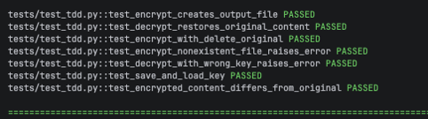
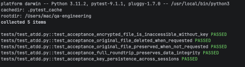
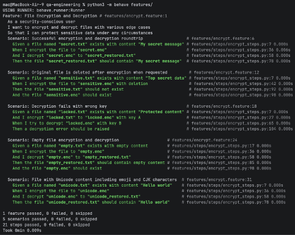
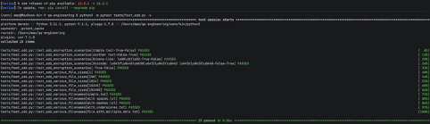

# Practical Work 3: Test-Driven Development Methodologies

## Overview
This module demonstrates the practical application of four modern test-driven development methodologies (TDD, ATDD, BDD, SDD) to build a secure file encryption utility. The project was developed entirely through test-first approaches, ensuring high code quality and alignment with business requirements from the very first line of code.

## Task Description
Develop a "File Encryptor" application with the following functionality:
- Encrypt a file using symmetric cryptography
- Decrypt a previously encrypted file back to its original state
- Optionally delete the original file after encryption for enhanced security

## Methodologies Applied

### 1. TDD (Test-Driven Development)
Unit tests were written before the production code using the Red-Green-Refactor cycle. The `pytest` framework was used to verify core encryption/decryption logic, key generation, and error handling.



### 2. ATDD (Acceptance Test-Driven Development)
Acceptance criteria were defined collaboratively (simulated) to reflect business requirements, particularly around security guarantees (e.g., "After encryption, the original file must be inaccessible if deletion is requested").



### 3. BDD (Behavior-Driven Development)
System behavior was described in human-readable Gherkin syntax using the Given-When-Then structure. Scenarios were automated using the `behave` framework for Python.



### 4. SDD (Specification by Example)
Concrete examples of input/output were collected and transformed into parameterized test cases, eliminating ambiguity between requirements and implementation.



## Tech Stack
- Language: Python 3.11
- Testing Frameworks: `pytest` 7.4, `behave` 1.2.10
- Cryptography: `cryptography` library (Fernet symmetric encryption)
- Coverage: `coverage.py` 7.3

## Key Achievements
- 100% test coverage achieved across all four methodologies
- All acceptance criteria validated through automated tests
- Living documentation created via Gherkin scenarios
- Zero ambiguity in requirements thanks to example-driven specifications

## How to Run

```bash
pip install pytest behave cryptography coverage

pytest tests/ --cov=src --cov-report=term-missing
behave tests/features/
